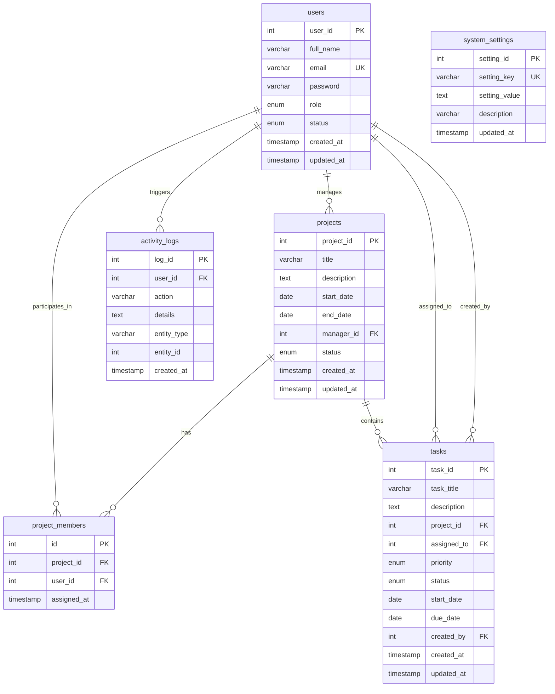

# ProTrack - Online Project Management Tool

> **Enterprise Web-Based Project Management Platform**  
> Developed using **Java 17**, **Jakarta Servlets (Tomcat 10)**, **JSP**, **JDBC**, **MySQL**, **Bootstrap 5**, and **Maven**.  
> Designed following the **Model-View-Controller (MVC)** architectural pattern for academic evaluation and enterprise demonstration.

---

## Table of Contents
1. [Project Overview & Key Objectives](#1-project-overview--key-objectives)
2. [Technology Stack](#2-technology-stack)
3. [MVC System Architecture](#3-mvc-system-architecture)
4. [Database Design & ER Diagram](#4-database-design--er-diagram)
5. [User Roles & Access Control Matrix](#5-user-roles--access-control-matrix)
6. [Core Java Concepts Demonstrated](#6-core-java-concepts-demonstrated)
7. [JDBC & Database Architecture Deep Dive](#7-jdbc--database-architecture-deep-dive)
8. [Servlet & Filter Implementation Details](#8-servlet--filter-implementation-details)
9. [Innovative & Standout Features](#9-innovative--standout-features)
10. [Step-by-Step Installation & Deployment](#10-step-by-step-installation--deployment)
11. [Default Login Accounts](#11-default-login-accounts)
12. [Testing & Quality Assurance Checklist](#12-testing--quality-assurance-checklist)

---

## 1. Project Overview & Key Objectives

**ProTrack** is a modern, fully functional, multi-tenant web application engineered to solve end-to-end project collaboration, milestone tracking, and task governance. It strictly avoids high-level "magic" frameworks like Spring Boot or Hibernate to demonstrate fundamental mastery of **Core Java**, **Jakarta Servlet API**, **JDBC database integration**, and **JSP presentation technology**.

### Core Objectives:
1. **Administrative Governance:** System administrators provision users, manage all company projects, configure global preferences, and analyze company-wide performance metrics.
2. **Project Manager Supervision:** Project managers plan initiatives, define sprint milestones, allocate tasks to team members with priorities and deadlines, and monitor real-time completion percentages.
3. **Team Member Execution:** Developers, designers, and QA engineers view assigned work items, update task progression states (TODO &rarr; IN PROGRESS &rarr; REVIEW &rarr; COMPLETED), track upcoming deadlines, and inspect assigned projects.
4. **Security & Authorization:** Strict role-based URL guards prevent privilege escalation or URL tampering via Servlet Filters.

---

## 2. Technology Stack

| Layer | Technology | Specification / Version |
| :--- | :--- | :--- |
| **Language** | Java | Java SE 17 (LTS) / Java 21 compatible |
| **Web Server / Servlet Container** | Apache Tomcat | Version 10.1+ (Jakarta EE 10 / Servlet 6.0) |
| **Database** | MySQL | MySQL 8.0+ (Strict fail-fast requirement, zero H2 fallback) |
| **Database Connectivity** | JDBC | `mysql-connector-j` 8.3.0 (`PreparedStatement`, ACID Transactions) |
| **Presentation Tier** | JSP & JSTL | Jakarta Server Pages 3.1 & JSTL 3.0 (with XML output escaping) |
| **Frontend Framework** | Bootstrap 5 | Bootstrap 5.3.3 & Bootstrap Icons 1.11.3 |
| **Visual Analytics** | Chart.js | Chart.js 4.4.1 (Doughnut & Bar charts) |
| **Password & Token Security** | BCrypt & SecureRandom | OpenBSD Blowfish password hashing & cryptographic CSRF tokens |
| **Build & Packaging Tool** | Apache Maven | Maven 3.9+ (Produces standard `protrack.war`) |
| **Automated Testing** | JUnit 5 & Mockito | 28 automated unit & mock-driven tests (JUnit Jupiter 5.10.2 + Mockito 5.11.0) |

---

## 3. MVC System Architecture

ProTrack strictly adheres to the industry-standard **Model-View-Controller (MVC)** architectural design:

```
                      Browser Client
                           │
                 HTTP Request (GET/POST)
                           ▼
          ┌───────────────────────────────────┐
          │  Jakarta Servlet Filter Pipeline  │
          │  - EncodingFilter (UTF-8)         │
          │  - AuthenticationFilter (RBAC)    │
          └─────────────────┬─────────────────┘
                            │ (Authorized Request)
                            ▼
     ┌─────────────────────────────────────────────┐
     │             CONTROLLER LAYER                │
     │  - LoginServlet / RegisterServlet / Logout  │
     │  - DashboardServlet (Role-based dispatcher) │
     │  - UserServlet / ProjectServlet             │
     │  - TaskServlet / ProfileServlet / Settings  │
     └──────────────────────┬──────────────────────┘
                            │ Delegates Business Logic
                            ▼
     ┌─────────────────────────────────────────────┐
     │              SERVICE LAYER                  │
     │  - AuthService / UserService / ProjectServ  │
     │  - TaskService / DashboardService (Metrics) │
     └──────────────────────┬──────────────────────┘
                            │ Data Access Invocations
                            ▼
     ┌─────────────────────────────────────────────┐
     │                 DAO LAYER                   │
     │  - UserDAO / ProjectDAO / TaskDAO           │
     │  - ActivityDAO / SettingsDAO (JDBC + SQL)   │
     └──────────────────────┬──────────────────────┘
                            │ PreparedStatement / Connection
                            ▼
     ┌─────────────────────────────────────────────┐
     │              DATABASE TIER                  │
     │         MySQL: project_management_db        │
     └─────────────────────────────────────────────┘
```

### Directory Structure:
```
protrack/
├── pom.xml                               # Maven project configuration (dependencies & plugins)
├── mvnw / mvnw.cmd                       # Maven wrapper scripts
├── database.sql                          # Database creation, schema & seed records
├── README.md                             # Comprehensive project documentation
├── src/
│   ├── main/
│   │   ├── java/com/protrack/
│   │   │   ├── exception/                # Custom business & database exceptions
│   │   │   ├── util/                     # BCrypt, DBConnection, CSRFTokenUtil, ValidationUtil
│   │   │   ├── model/                    # Domain entities, OOP inheritance & enums
│   │   │   ├── dao/                      # GenericDAO and entity DAO interfaces
│   │   │   │   └── impl/                 # JDBC implementations with PreparedStatements
│   │   │   ├── service/                  # Business logic, metrics & ownership checks
│   │   │   ├── filter/                   # EncodingFilter & AuthenticationFilter (RBAC + CSRF + Matrix guard)
│   │   │   └── servlet/                  # Jakarta HTTP Servlets (Controllers)
│   │   ├── resources/
│   │   │   ├── db.properties             # Database connection credentials (env overrides supported)
│   │   │   └── database.sql              # Packaged schema resource
│   │   └── webapp/
│   │       ├── index.jsp                 # Smart root landing / dispatcher
│   │       ├── assets/
│   │       │   ├── css/style.css         # Modern SaaS stylesheet (navy/purple)
│   │       │   └── js/main.js            # Modals, client search, alerts & charts
│   │       └── WEB-INF/
│   │           ├── web.xml               # Deployment descriptor & error mappings
│   │           └── views/                # Protected JSP presentation templates (XML-escaped)
│   │               ├── common/           # Header, sidebar, navbar, footer, alerts
│   │               ├── auth/             # Login and register pages (CSRF protected)
│   │               ├── admin/            # Admin dashboard, users, projects, settings
│   │               ├── manager/          # PM dashboard, projects, tasks, detail
│   │               ├── member/           # Member dashboard, my tasks, projects
│   │               ├── error/            # Custom 403, 404, 500 error views
│   │               ├── profile.jsp       # User profile & password modification
│   │               └── activity.jsp      # System audit trail and activity feed
│   └── test/
│       ├── java/com/protrack/
│       │   ├── dao/ProjectDAORollbackTest.java     # Atomic transaction rollback tests
│       │   ├── filter/SecurityRBACAndAuthTest.java # RBAC, matrix URL bypass & CSRF tests
│       │   ├── service/TaskAuthorizationTest.java  # Task ownership & status update tests
│       │   ├── service/RegistrationSecurityTest.java # Role escalation & 8-char password tests
│       │   ├── util/XSSSanitizationTest.java       # HTML/script injection neutralization tests
│       │   └── ProTrackUnitTest.java               # Core unit tests (BCrypt, validation, enums)
│       └── resources/
│           └── mockito-extensions/                 # Java 21 compatible mock-maker-subclass
```

---

## 4. Database Design & ER Diagram

The database `project_management_db` is normalized up to **Third Normal Form (3NF)** with explicit foreign key constraints, indexes on lookup columns, and cascade rules.



---

## 5. User Roles & Access Control Matrix

| Capability / Module | ADMIN | PROJECT_MANAGER | TEAM_MEMBER |
| :--- | :---: | :---: | :---: |
| **Access Admin Dashboard (`/admin/*`)** | :white_check_mark: Yes | :x: No (403) | :x: No (403) |
| **Manage Users (CRUD, Role Assignment)** | :white_check_mark: Yes | :x: No | :x: No |
| **Configure System Settings** | :white_check_mark: Yes | :x: No | :x: No |
| **Create Projects** | :white_check_mark: Yes | :white_check_mark: Yes | :x: No |
| **Edit / Delete Projects** | :white_check_mark: Yes | :white_check_mark: Yes (Managed projects only) | :x: No |
| **Assign Members to Projects** | :white_check_mark: Yes | :white_check_mark: Yes (Managed projects only) | :x: No |
| **Create Tasks** | :white_check_mark: Yes | :white_check_mark: Yes (Managed projects only) | :x: No (Blocked in Filter & Servlet) |
| **Edit / Delete Tasks** | :white_check_mark: Yes | :white_check_mark: Yes (Managed projects only) | :x: No (Blocked in Filter & Servlet) |
| **View Assigned Tasks** | :white_check_mark: Yes | :white_check_mark: Yes | :white_check_mark: Yes |
| **Update Task Status (TODO &rarr; COMPLETED)** | :white_check_mark: Yes | :white_check_mark: Yes | :white_check_mark: Yes (**Own assigned tasks only** - ownership verified) |
| **Self-Registration Role Assignment** | N/A (Admin only) | :x: Prevented | :white_check_mark: Yes (Forced strictly to `TEAM_MEMBER`) |
| **Update Personal Profile & Password** | :white_check_mark: Yes | :white_check_mark: Yes | :white_check_mark: Yes (Minimum 8 chars) |
| **View Audit Trail Activity Feed** | :white_check_mark: Yes | :white_check_mark: Yes | :white_check_mark: Yes |

> **Task Ownership Enforcement:** Even though `TaskServlet` handles status updates, backend business logic (`TaskService.updateTaskStatusWithRoleCheck`) cryptographically checks if the logged-in user is an Admin, the Project Manager of the project, or the exact `assignedTo` user. Team members cannot tamper with or update tasks belonging to other team members.

---

## 6. Core Java Concepts Demonstrated

### A. Object-Oriented Programming (OOP)
1. **Abstraction:**
   - `BaseEntity` abstract class encapsulates identity (`id`) and timestamp audit fields (`createdAt`, `updatedAt`).
   - `GenericDAO<T, ID>` interface defines standard CRUD contracts without leaking JDBC details.
2. **Inheritance:**
   - Hierarchy: `BaseEntity` &rarr; `User` &rarr; `Admin`, `ProjectManager`, `TeamMember`.
   - Each subclass inherits common credentials and identity from `User`.
3. **Polymorphism:**
   - Role capability methods defined in `User` (`canManageUsers()`, `canManageProjects()`, `canAssignTasks()`, `getDashboardUrl()`) are overridden polymorphically in `Admin`, `ProjectManager`, and `TeamMember`.
   - Factory pattern: `UserFactory.createUser(role, ...)` instantiates the correct concrete subtype dynamically.
4. **Encapsulation:**
   - All model fields are `private` or `protected` with strictly validated getters, setters, and constructors.

### B. Exception Handling Architecture
- **Custom Hierarchy:**
  - `AppException`: Root custom checked exception for expected business violations.
  - `UserNotFoundException`, `ProjectNotFoundException`, `InvalidCredentialsException`, `TaskAssignmentException`, `UnauthorizedAccessException`.
  - `DatabaseOperationException`: Unchecked runtime wrapper for low-level `SQLException`.
- **Try-Catch-Finally / Try-with-Resources:**
  - All database queries employ Java 7+ try-with-resources to guarantee connection and statement closure even if SQL failures occur.

### C. Collections and Generics
- Extensive use of generic collections: `List<User>`, `List<Project>`, `List<Task>`, `Map<String, Object>`, `EnumMap<TaskStatus, Integer>`.
- Generics in DAO pattern: `GenericDAO<T, ID>` enables reusable interfaces for any entity.

---

## 7. JDBC & Database Architecture Deep Dive

1. **PreparedStatement Protection:**
   - All queries use parameterized `?` placeholders. No dynamic SQL string concatenation is used for user input, completely defeating SQL Injection attacks.
2. **Strict Fail-Fast MySQL Connectivity (Zero H2 Fallback):**
   - `DBConnection` centralizes driver loading and connection pooling/acquisition using `DriverManager`. It reads `db.properties` from classpath and supports environment variable overrides (`DB_URL`, `DB_USER`, `DB_PASSWORD`, `DB_DRIVER`).
   - To guarantee architectural integrity and prevent split-database corruption, **there is zero silent fallback to embedded databases (H2 removed)**. If MySQL is unreachable, `DBConnection` immediately and loudly throws a descriptive `SQLException` detailing the JDBC URL, host, and port.
3. **JDBC Transactions (ACID Support) & Verified Rollback:**
   - In `ProjectDAOImpl.saveWithMembers()`, multi-table atomic persistence is guaranteed:
     ```java
     conn.setAutoCommit(false);
     // 1. Insert project record -> retrieve generated project_id
     // 2. Batch insert project_members
     conn.commit(); // Atomically committed upon total success
     // In catch block:
     DBConnection.rollback(conn); // Rolled back on any batch failure
     conn.setAutoCommit(true);    // Connection state cleanly restored
     ```
   - This transaction rollback behavior is covered by automated mock-driven unit tests (`ProjectDAORollbackTest`), verifying that failure at any point triggers `conn.rollback()` and properly restores auto-commit state.

---

## 8. Servlet & Filter Implementation Details

1. **Servlet Filter Pipeline & Security Guards:**
   - `EncodingFilter`: Intercepts `/*` and sets `UTF-8` character encoding for all requests and responses.
   - `AuthenticationFilter`:
     - **Matrix URL Parameter Defense:** Strips semicolon matrix parameters (`path.substring(0, semi)`) from incoming request paths before evaluating authorization rules. A malicious URL like `/manager/tasks;x=.css` cannot bypass authentication filters.
     - **Path-Based Whitelisting:** Public endpoints (`/login`, `/register`, `/logout`) and static assets strictly within `/assets/*` are permitted. All application URLs (`/admin/*`, `/manager/*`, `/member/*`, `/profile`, `/tasks`, `/projects`) require active session authentication and appropriate role permissions. Mismatches return HTTP 403 Forbidden.
     - **CSRF Token Validation:** All state-changing `POST` requests for authenticated operations (user management, project creation/editing, task manipulation, system settings, and profile updates) are validated against a cryptographically secure per-session token generated by `CSRFTokenUtil`. Requests with missing or mismatched tokens are rejected immediately with HTTP 403 Forbidden. The public pre-authentication login form uses standard credential submission.
2. **Session Management & Cookie Hardening:**
   - `request.getSession(true)` initializes authenticated user state.
   - **Session Fixation Prevention:** Upon successful credential validation, `LoginServlet` invokes `request.changeSessionId()`, rotating the session ID while preserving session state to defeat session hijacking attacks.
   - **Cookie Configuration:** The `PROTRACK_SESSION` cookie is configured with `<http-only>true</http-only>` to block client-side JavaScript access. For production deployments with TLS/HTTPS, `<secure>true</secure>` can be enabled in `web.xml`.
   - Session timeout set to 30 minutes in `web.xml`.
   - `session.invalidate()` cleanly flushes session state on logout.
   - Flash message pattern: One-time notification banners stored in session and automatically cleared upon rendering.
3. **Context-Aware JSP Output Escaping (Defeating Double-Escaping):**
   - **Clean Database Records:** User input (such as project titles containing special characters, e.g., "R&D Team" or "Q&A System") is stored in its natural raw form in the database without premature entity encoding. Input validation in services verifies length and format constraints.
   - **Contextual Output Escaping in JSPs:** All dynamic user data rendered in JSPs is safely escaped at display time using `<%= ValidationUtil.escapeXml(...) %>` (converting `<`, `>`, `&`, `"`, `'` into safe XML entities). This strictly avoids double-escaping anomalies (e.g., preventing `R&D Team` from turning into `R&amp;amp;D Team`) while thoroughly neutralizing stored and reflected XSS attacks.
4. **Strong Password Policy:**
   - Password minimum length is strictly enforced to at least 8 characters across frontend HTML5 validators, `ValidationUtil.isStrongPassword()`, and backend service layers.

---

## 9. Innovative & Standout Features

1. **Automated Deadline & Overdue Identification:** Real-time SQL comparisons against `CURRENT_DATE()` instantly flag overdue tasks with pulsing red badges.
2. **Dynamic Project Completion Metrics:** Mathematical formula `(completedTasks / totalTasks) * 100` dynamically calculates live project progress bars.
3. **Comprehensive Audit Logging:** Every create, update, delete, status transition, and login action is recorded into the `activity_logs` table.
4. **Interactive Dashboard Charts:** Chart.js integration plots project status doughnuts and task priority bar charts from live database counts.
5. **Quick-Fill Demo Credentials:** One-click demo chips on the login screen automatically populate credentials for rapid viva evaluation.

---

## 10. Step-by-Step Installation & Deployment

### Prerequisites
- **Java Development Kit (JDK):** Version 17 or higher
- **Apache Tomcat:** Version 10.1 or higher (Jakarta EE 10)
- **MySQL Database Server:** Version 8.0 or higher
- **Apache Maven:** Version 3.8+ (An embedded wrapper `./mvnw` is also included)

### Step 1: Database Setup
1. Open your terminal or MySQL Workbench.
2. Log in to MySQL:
   ```bash
   mysql -u root -p
   ```
3. Run the provided `database.sql` script:
   ```sql
   source /path/to/project/database.sql;
   ```
   *(Or copy-paste the entire contents of `database.sql` into MySQL Workbench and execute).*

### Step 2: Configure Database Credentials
Edit `src/main/resources/db.properties` to match your local MySQL configuration:
```properties
db.driver=com.mysql.cj.jdbc.Driver
db.url=jdbc:mysql://localhost:3306/project_management_db?useSSL=false&allowPublicKeyRetrieval=true&serverTimezone=UTC&characterEncoding=UTF-8
db.user=root
db.password=your_mysql_password
```

> [!IMPORTANT]
> The repository includes default credentials (`root/root`) for convenience during local evaluation. **You should update `db.user` and `db.password` to match your local MySQL account**, or provide them as environment variables (`DB_URL`, `DB_USER`, `DB_PASSWORD`) which automatically take precedence without modifying source files.

### Step 3: Automated Database Verification (Optional)
Run the built-in database initializer to test connectivity:
```bash
./mvnw test-compile exec:java -Dexec.mainClass="com.protrack.util.DatabaseInitializer"
```

### Step 4: Build the Project with Maven
Open terminal in the project directory and build the deployable `.war` archive:
```bash
./mvnw clean package
```
*(On Windows, run `mvnw.cmd clean package` or standard `mvn clean package`).*

Upon success, Maven creates:
```
target/protrack.war
```

### Step 5: Deploy to Apache Tomcat 10
1. Copy `target/protrack.war` to your Tomcat `webapps/` folder:
   ```bash
   cp target/protrack.war /path/to/apache-tomcat-10.1.x/webapps/
   ```
2. Start Apache Tomcat:
   ```bash
   # On macOS / Linux
   /path/to/apache-tomcat-10.1.x/bin/startup.sh

   # On Windows
   C:\path\to\apache-tomcat-10.1.x\bin\startup.bat
   ```
3. Open your web browser and navigate to:
   ```
   http://localhost:8085/protrack
   (or http://localhost:8085/ or http://localhost:8080/protrack)
   ```

---

## 11. Default Login Accounts

| Role | Email Address | Password | Description / Use Case |
| :--- | :--- | :--- | :--- |
| **ADMIN** | `admin@protrack.com` | `admin123` | Full system governance, user CRUD, system settings |
| **PROJECT_MANAGER** | `sarah.pm@protrack.com` | `manager123` | Leads E-Commerce, Cloud Migration & HR Portal |
| **PROJECT_MANAGER** | `david.pm@protrack.com` | `manager123` | Leads Mobile Banking & AI Chatbot projects |
| **TEAM_MEMBER** | `alex.dev@protrack.com` | `member123` | Senior Full-Stack Developer with multiple tasks |
| **TEAM_MEMBER** | `emma.qa@protrack.com` | `member123` | Quality Assurance Engineer |
| **TEAM_MEMBER** | `liam.design@protrack.com` | `member123` | UI/UX Designer |
| **TEAM_MEMBER** | `sophia.dev@protrack.com` | `member123` | Backend & Cloud Infrastructure Developer |

---

## 12. Testing & Quality Assurance Checklist

ProTrack includes an extensive automated test suite built on **JUnit 5 (Jupiter)** and **Mockito 5**. All tests run completely offline and independent of external database state via mock drivers and isolated unit logic.

Execute the entire test suite using:
```bash
./mvnw test
```

### Automated Test Suite Overview (28 Tests — 100% Passing):

| Test Suite Class | Tests | Category | Key Assertions & Scenarios Verified |
| :--- | :---: | :--- | :--- |
| **`ProjectDAORollbackTest`** | 2 | DAO Mock & Unit | • Atomic rollback on batch failure: verifies `conn.rollback()` is invoked, auto-commit is restored, and `DatabaseOperationException` is thrown using mocked JDBC connection<br>• Clean commit on valid project and member batch insertion |
| **`SecurityRBACAndAuthTest`** | 7 | Security & Filters | • Unauthenticated requests safely redirected to `/login`<br>• Semicolon matrix parameter auth bypass neutralized (`/manager/tasks;x=.css` denied)<br>• RBAC role mismatch returns HTTP 403 Forbidden<br>• Static asset whitelist (`/assets/*`) bypasses auth without risk<br>• Missing CSRF token on POST yields HTTP 403<br>• Invalid CSRF token on POST yields HTTP 403<br>• Valid session CSRF token on POST passes filter successfully |
| **`TaskAuthorizationTest`** | 4 | Service & Auth | • Team members can update status on tasks assigned directly to their `userId`<br>• Team members denied with `UnauthorizedAccessException` when attempting to alter unassigned tasks<br>• Team members denied when attempting to alter other team members' tasks<br>• Administrators can update status of any task across all projects |
| **`RegistrationSecurityTest`** | 5 | Service & Validation | • Passwords shorter than 8 characters strictly rejected<br>• Raw special characters (e.g. & in 'R&D') preserved cleanly in storage without premature entity encoding<br>• Role escalation prevented: public registrations forced strictly to `Role.TEAM_MEMBER`<br>• Duplicate email registrations rejected with `AppException`<br>• Registration policy check rejects signups when registration is disabled in settings |
| **`XSSSanitizationTest`** | 4 | Security Utilities | • JSP output escaping (`escapeXml`) neutralizes dangerous `<script>` and `javascript:` payloads<br>• Neutralizes HTML attribute breakout attacks (`">• Converts `&`, `<`, `>`, `"`, `'` to safe XML entities once without double-escaping real-world names (e.g. `R&D Team` renders cleanly)<br>• Gracefully handles `null` and empty string inputs |
| **`ProTrackUnitTest`** | 6 | Core Unit Tests | • BCrypt salt generation and password verification<br>• Rejection of passwords with insufficient length (< 8 chars)<br>• Email format regex validation<br>• Date calculations and overdue detection<br>• TaskStatus and Priority enum display mappings<br>• Polymorphic role capability checks on concrete `User` subtypes |

```
[INFO] Results:
[INFO] Tests run: 28, Failures: 0, Errors: 0, Skipped: 0
[INFO] BUILD SUCCESS
```

### Functional Verification Matrix:
- [x] **Authentication & Session Fixation:** Login with valid credentials invokes `request.changeSessionId()` and redirects to role-specific dashboard.
- [x] **CSRF Protection:** Per-session cryptographic token required on state-changing authenticated POST forms.
- [x] **URL Matrix Parameter Defense:** Semicolon path parameters (`/manager/tasks;x=.css`) stripped and blocked from filter bypass.
- [x] **Role Authorization:** Accessing `/admin/users` as a Team Member produces a 403 Forbidden page.
- [x] **Task Ownership Enforcement:** Team members can only update status of their own assigned tasks.
- [x] **Role Escalation Prevention:** Public registration form forced strictly to `Role.TEAM_MEMBER`.
- [x] **Password Security:** BCrypt Blowfish hashing with 8-character minimum policy verified; plain-text passwords are never stored.
- [x] **Zero H2 Fallback:** `DBConnection` strictly enforces MySQL with loud `SQLException` on failure.
- [x] **Atomic Transactions:** Project batch persistence verified with automated rollback on failure.
- [x] **User Management:** Admin can add, search, edit, and delete user accounts.
- [x] **Project Management:** Project creation with manager assignment and member selection succeeds.
- [x] **Live Calculations:** Project completion percentages recalculate dynamically upon task completion.
- [x] **Deadline Alerts:** Overdue and Due Today tasks trigger warning badges.
- [x] **Audit Trail:** Modifying a task or project creates an entry in `activity_logs`.
- [x] **Context-Aware Output Escaping:** Dynamic JSP escaping via `ValidationUtil.escapeXml()` prevents XSS and avoids double-escaping raw text like "R&D".

---

&copy; **ProTrack - Online Project Management Tool**. Built for Academic Evaluation.
