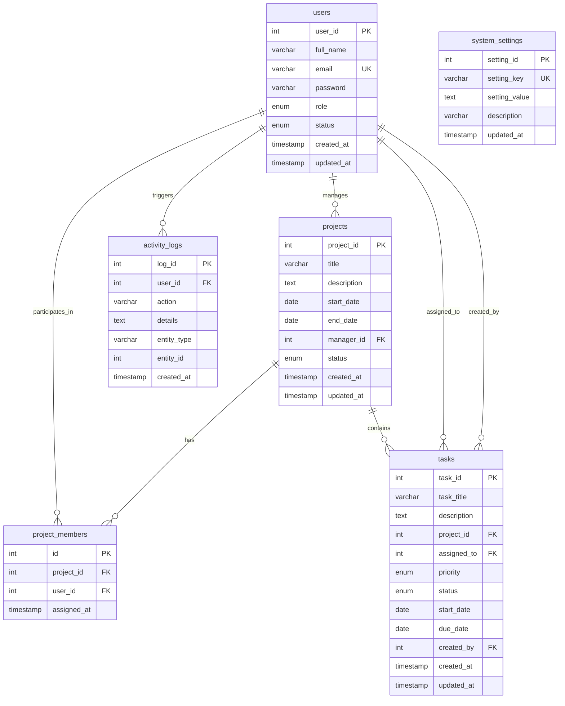

# ProTrack - Online Project Management Tool

> **Enterprise Web-Based Project Management Platform**  
> Developed using **Java 17**, **Jakarta Servlets (Tomcat 10)**, **JSP**, **JDBC**, **MySQL**, **Bootstrap 5**, and **Maven**.  
> Designed following the **Model-View-Controller (MVC)** architectural pattern for academic evaluation and enterprise demonstration.

---

## Table of Contents
1. [Project Overview & Key Objectives](#1-project-overview--key-objectives)
2. [Technology Stack](#2-technology-stack)
3. [MVC System Architecture](#3-mvc-system-architecture)
4. [Database Design & ER Diagram](#4-database-design--er-diagram)
5. [User Roles & Access Control Matrix](#5-user-roles--access-control-matrix)
6. [Core Java Concepts Demonstrated (Viva Reference)](#6-core-java-concepts-demonstrated-viva-reference)
7. [JDBC & Database Architecture Deep Dive](#7-jdbc--database-architecture-deep-dive)
8. [Servlet & Filter Implementation Details](#8-servlet--filter-implementation-details)
9. [Innovative & Standout Features](#9-innovative--standout-features)
10. [Step-by-Step Installation & Deployment](#10-step-by-step-installation--deployment)
11. [Default Login Accounts](#11-default-login-accounts)
12. [Testing & Quality Assurance Checklist](#12-testing--quality-assurance-checklist)
13. [Top 10 Viva Questions & Detailed Answers](#13-top-10-viva-questions--detailed-answers)

---

## 1. Project Overview & Key Objectives

**ProTrack** is a modern, fully functional, multi-tenant web application engineered to solve end-to-end project collaboration, milestone tracking, and task governance. It strictly avoids high-level "magic" frameworks like Spring Boot or Hibernate to demonstrate fundamental mastery of **Core Java**, **Jakarta Servlet API**, **JDBC database integration**, and **JSP presentation technology**.

### Core Objectives:
1. **Administrative Governance:** System administrators provision users, manage all company projects, configure global preferences, and analyze company-wide performance metrics.
2. **Project Manager Supervision:** Project managers plan initiatives, define sprint milestones, allocate tasks to team members with priorities and deadlines, and monitor real-time completion percentages.
3. **Team Member Execution:** Developers, designers, and QA engineers view assigned work items, update task progression states (TODO &rarr; IN PROGRESS &rarr; REVIEW &rarr; COMPLETED), track upcoming deadlines, and inspect assigned projects.
4. **Security & Authorization:** Strict role-based URL guards prevent privilege escalation or URL tampering via Servlet Filters.

---

## 2. Technology Stack

| Layer | Technology | Specification / Version |
| :--- | :--- | :--- |
| **Language** | Java | Java SE 17 (LTS) / Java 21 compatible |
| **Web Server / Servlet Container** | Apache Tomcat | Version 10.1+ (Jakarta EE 10 / Servlet 6.0) |
| **Database** | MySQL | MySQL 8.0+ / MariaDB 10.3+ |
| **Database Connectivity** | JDBC | `mysql-connector-j` 8.3.0 (`PreparedStatement`, Transactions) |
| **Presentation Tier** | JSP & JSTL | Jakarta Server Pages 3.1 & JSTL 3.0 |
| **Frontend Framework** | Bootstrap 5 | Bootstrap 5.3.3 & Bootstrap Icons 1.11.3 |
| **Visual Analytics** | Chart.js | Chart.js 4.4.1 (Doughnut & Bar charts) |
| **Password Security** | BCrypt | OpenBSD Blowfish password hashing (cost factor 10) |
| **Build & Packaging Tool** | Apache Maven | Maven 3.9+ (Produces standard `protrack.war`) |
| **Unit Testing** | JUnit 5 | JUnit Jupiter 5.10.2 |

---

## 3. MVC System Architecture

ProTrack strictly adheres to the industry-standard **Model-View-Controller (MVC)** architectural design:

```
                      Browser Client
                           │
                 HTTP Request (GET/POST)
                           ▼
          ┌───────────────────────────────────┐
          │  Jakarta Servlet Filter Pipeline  │
          │  - EncodingFilter (UTF-8)         │
          │  - AuthenticationFilter (RBAC)    │
          └─────────────────┬─────────────────┘
                            │ (Authorized Request)
                            ▼
     ┌─────────────────────────────────────────────┐
     │             CONTROLLER LAYER                │
     │  - LoginServlet / RegisterServlet / Logout  │
     │  - DashboardServlet (Role-based dispatcher) │
     │  - UserServlet / ProjectServlet             │
     │  - TaskServlet / ProfileServlet / Settings  │
     └──────────────────────┬──────────────────────┘
                            │ Delegates Business Logic
                            ▼
     ┌─────────────────────────────────────────────┐
     │              SERVICE LAYER                  │
     │  - AuthService / UserService / ProjectServ  │
     │  - TaskService / DashboardService (Metrics) │
     └──────────────────────┬──────────────────────┘
                            │ Data Access Invocations
                            ▼
     ┌─────────────────────────────────────────────┐
     │                 DAO LAYER                   │
     │  - UserDAO / ProjectDAO / TaskDAO           │
     │  - ActivityDAO / SettingsDAO (JDBC + SQL)   │
     └──────────────────────┬──────────────────────┘
                            │ PreparedStatement / Connection
                            ▼
     ┌─────────────────────────────────────────────┐
     │              DATABASE TIER                  │
     │         MySQL: project_management_db        │
     └─────────────────────────────────────────────┘
```

### Directory Structure:
```
protrack/
├── pom.xml                               # Maven project configuration
├── mvnw / mvnw.cmd                       # Embedded Maven wrapper
├── database.sql                          # Database creation, schema & seed records
├── README.md                             # Comprehensive project documentation
├── lib/                                  # Local compile-time dependencies
├── src/
│   ├── main/
│   │   ├── java/com/protrack/
│   │   │   ├── exception/                # Custom business & database exceptions
│   │   │   ├── util/                     # BCrypt, DBConnection, DateUtil, Validation
│   │   │   ├── model/                    # Domain entities, OOP inheritance & enums
│   │   │   ├── dao/                      # GenericDAO and entity DAO interfaces
│   │   │   │   └── impl/                 # JDBC implementations with PreparedStatements
│   │   │   ├── service/                  # Business logic, metrics & orchestration
│   │   │   ├── filter/                   # EncodingFilter & AuthenticationFilter (RBAC)
│   │   │   └── servlet/                  # Jakarta HTTP Servlets (Controllers)
│   │   ├── resources/
│   │   │   ├── db.properties             # Database connection credentials
│   │   │   └── database.sql              # Packaged schema resource
│   │   └── webapp/
│   │       ├── index.jsp                 # Smart root landing / dispatcher
│   │       ├── assets/
│   │       │   ├── css/style.css         # Modern SaaS stylesheet (navy/purple)
│   │       │   └── js/main.js            # Modals, client search, alerts & charts
│   │       └── WEB-INF/
│   │           ├── web.xml               # Deployment descriptor & error mappings
│   │           ├── lib/                  # Runtime libraries for WAR bundle
│   │           └── views/                # Protected JSP presentation templates
│   │               ├── common/           # Header, sidebar, navbar, footer, alerts
│   │               ├── auth/             # Login and register pages
│   │               ├── admin/            # Admin dashboard, users, projects, settings
│   │               ├── manager/          # PM dashboard, projects, tasks, detail
│   │               ├── member/           # Member dashboard, my tasks, projects
│   │               ├── error/            # Custom 403, 404, 500 error views
│   │               ├── profile.jsp       # User profile & password modification
│   │               └── activity.jsp      # System audit trail and activity feed
│   └── test/
│       └── java/com/protrack/
│           └── ProTrackUnitTest.java     # Automated JUnit 5 test suite
```

---

## 4. Database Design & ER Diagram

The database `project_management_db` is normalized up to **Third Normal Form (3NF)** with explicit foreign key constraints, indexes on lookup columns, and cascade rules.



---

## 5. User Roles & Access Control Matrix

| Capability / Module | ADMIN | PROJECT_MANAGER | TEAM_MEMBER |
| :--- | :---: | :---: | :---: |
| **Access Admin Dashboard (`/admin/*`)** | :white_check_mark: Yes | :x: No (403) | :x: No (403) |
| **Manage Users (CRUD, Role Assignment)** | :white_check_mark: Yes | :x: No | :x: No |
| **Configure System Settings** | :white_check_mark: Yes | :x: No | :x: No |
| **Create Projects** | :white_check_mark: Yes | :white_check_mark: Yes | :x: No |
| **Edit / Delete Projects** | :white_check_mark: Yes | :white_check_mark: Yes (Own) | :x: No |
| **Assign Members to Projects** | :white_check_mark: Yes | :white_check_mark: Yes | :x: No |
| **Create & Assign Tasks** | :white_check_mark: Yes | :white_check_mark: Yes | :x: No |
| **Edit / Delete Tasks** | :white_check_mark: Yes | :white_check_mark: Yes | :x: No |
| **View Assigned Tasks** | :white_check_mark: Yes | :white_check_mark: Yes | :white_check_mark: Yes |
| **Update Task Status (TODO &rarr; COMPLETED)** | :white_check_mark: Yes | :white_check_mark: Yes | :white_check_mark: Yes |
| **Update Personal Profile & Password** | :white_check_mark: Yes | :white_check_mark: Yes | :white_check_mark: Yes |
| **View Audit Trail Activity Feed** | :white_check_mark: Yes | :white_check_mark: Yes | :white_check_mark: Yes |

---

## 6. Core Java Concepts Demonstrated (Viva Reference)

### A. Object-Oriented Programming (OOP)
1. **Abstraction:**
   - `BaseEntity` abstract class encapsulates identity (`id`) and timestamp audit fields (`createdAt`, `updatedAt`).
   - `GenericDAO<T, ID>` interface defines standard CRUD contracts without leaking JDBC details.
2. **Inheritance:**
   - Hierarchy: `BaseEntity` &rarr; `User` &rarr; `Admin`, `ProjectManager`, `TeamMember`.
   - Each subclass inherits common credentials and identity from `User`.
3. **Polymorphism:**
   - Role capability methods defined in `User` (`canManageUsers()`, `canManageProjects()`, `canAssignTasks()`, `getDashboardUrl()`) are overridden polymorphically in `Admin`, `ProjectManager`, and `TeamMember`.
   - Factory pattern: `UserFactory.createUser(role, ...)` instantiates the correct concrete subtype dynamically.
4. **Encapsulation:**
   - All model fields are `private` or `protected` with strictly validated getters, setters, and constructors.

### B. Exception Handling Architecture
- **Custom Hierarchy:**
  - `AppException`: Root custom checked exception for expected business violations.
  - `UserNotFoundException`, `ProjectNotFoundException`, `InvalidCredentialsException`, `TaskAssignmentException`, `UnauthorizedAccessException`.
  - `DatabaseOperationException`: Unchecked runtime wrapper for low-level `SQLException`.
- **Try-Catch-Finally / Try-with-Resources:**
  - All database queries employ Java 7+ try-with-resources to guarantee connection and statement closure even if SQL failures occur.

### C. Collections and Generics
- Extensive use of generic collections: `List<User>`, `List<Project>`, `List<Task>`, `Map<String, Object>`, `EnumMap<TaskStatus, Integer>`.
- Generics in DAO pattern: `GenericDAO<T, ID>` enables reusable interfaces for any entity.

---

## 7. JDBC & Database Architecture Deep Dive

1. **PreparedStatement Protection:**
   - All queries use parameterized `?` placeholders. No string concatenation is used for user input, completely defeating SQL Injection attacks.
2. **Connection Lifecycle & Singleton:**
   - `DBConnection` centralizes driver loading and connection acquisition using `DriverManager`. It reads `db.properties` from classpath and gracefully supports environment variable overrides (`DB_URL`, `DB_USER`, `DB_PASSWORD`).
3. **JDBC Transactions (ACID Support):**
   - In `ProjectDAOImpl.saveWithMembers()`, multi-table atomic persistence is demonstrated:
     ```java
     conn.setAutoCommit(false);
     // Insert project record -> retrieve generated project_id
     // Batch insert project_members
     conn.commit(); // Atomically committed
     // in catch:
     DBConnection.rollback(conn); // Rolled back on any failure
     ```

---

## 8. Servlet & Filter Implementation Details

1. **Servlet Filter Pipeline:**
   - `EncodingFilter`: Intercepts `/*` and sets `UTF-8` character encoding for all requests and responses.
   - `AuthenticationFilter`: Enforces session validation on all protected paths. Inspects `currentUser.getRole()` to prevent users from tampering with browser URLs (e.g., team members attempting to access `/admin/users` receive a custom 403 Forbidden page).
2. **Session Management:**
   - `request.getSession(true)` initializes authenticated user state.
   - Session timeout set to 30 minutes in `web.xml`.
   - `session.invalidate()` ensures secure logout.
   - Flash message pattern: One-time notification banners stored in session and automatically cleared upon rendering.

---

## 9. Innovative & Standout Features

1. **Automated Deadline & Overdue Identification:** Real-time SQL comparisons against `CURRENT_DATE()` instantly flag overdue tasks with pulsing red badges.
2. **Dynamic Project Completion Metrics:** Mathematical formula `(completedTasks / totalTasks) * 100` dynamically calculates live project progress bars.
3. **Comprehensive Audit Logging:** Every create, update, delete, status transition, and login action is recorded into the `activity_logs` table.
4. **Interactive Dashboard Charts:** Chart.js integration plots project status doughnuts and task priority bar charts from live database counts.
5. **Quick-Fill Demo Credentials:** One-click demo chips on the login screen automatically populate credentials for rapid viva evaluation.

---

## 10. Step-by-Step Installation & Deployment

### Prerequisites
- **Java Development Kit (JDK):** Version 17 or higher
- **Apache Tomcat:** Version 10.1 or higher (Jakarta EE 10)
- **MySQL Database Server:** Version 8.0 or higher
- **Apache Maven:** Version 3.8+ (An embedded wrapper `./mvnw` is also included)

### Step 1: Database Setup
1. Open your terminal or MySQL Workbench.
2. Log in to MySQL:
   ```bash
   mysql -u root -p
   ```
3. Run the provided `database.sql` script:
   ```sql
   source /path/to/project/database.sql;
   ```
   *(Or copy-paste the entire contents of `database.sql` into MySQL Workbench and execute).*

### Step 2: Configure Database Credentials
Edit `src/main/resources/db.properties` to match your local MySQL configuration:
```properties
db.driver=com.mysql.cj.jdbc.Driver
db.url=jdbc:mysql://localhost:3306/project_management_db?useSSL=false&allowPublicKeyRetrieval=true&serverTimezone=UTC&characterEncoding=UTF-8
db.user=root
db.password=your_mysql_password
```

### Step 3: Automated Database Verification (Optional)
Run the built-in database initializer to test connectivity:
```bash
java -cp target/classes:lib/* com.protrack.util.DatabaseInitializer
```

### Step 4: Build the Project with Maven
Open terminal in the project directory and build the deployable `.war` archive:
```bash
./mvnw clean package
```
*(On Windows, run `mvnw.cmd clean package` or standard `mvn clean package`).*

Upon success, Maven creates:
```
target/protrack.war
```

### Step 5: Deploy to Apache Tomcat 10
1. Copy `target/protrack.war` to your Tomcat `webapps/` folder:
   ```bash
   cp target/protrack.war /path/to/apache-tomcat-10.1.x/webapps/
   ```
2. Start Apache Tomcat:
   ```bash
   # On macOS / Linux
   /path/to/apache-tomcat-10.1.x/bin/startup.sh

   # On Windows
   C:\path\to\apache-tomcat-10.1.x\bin\startup.bat
   ```
3. Open your web browser and navigate to:
   ```
   http://localhost:8085/protrack
   (or http://localhost:8085/ or http://localhost:8080/protrack)
   ```

---

## 11. Default Login Accounts

| Role | Email Address | Password | Description / Use Case |
| :--- | :--- | :--- | :--- |
| **ADMIN** | `admin@protrack.com` | `admin123` | Full system governance, user CRUD, system settings |
| **PROJECT_MANAGER** | `sarah.pm@protrack.com` | `manager123` | Leads E-Commerce, Cloud Migration & HR Portal |
| **PROJECT_MANAGER** | `david.pm@protrack.com` | `manager123` | Leads Mobile Banking & AI Chatbot projects |
| **TEAM_MEMBER** | `alex.dev@protrack.com` | `member123` | Senior Full-Stack Developer with multiple tasks |
| **TEAM_MEMBER** | `emma.qa@protrack.com` | `member123` | Quality Assurance Engineer |
| **TEAM_MEMBER** | `liam.design@protrack.com` | `member123` | UI/UX Designer |
| **TEAM_MEMBER** | `sophia.dev@protrack.com` | `member123` | Backend & Cloud Infrastructure Developer |

---

## 12. Testing & Quality Assurance Checklist

You can verify all unit tests at any time using:
```bash
./mvnw test
```

### Functional Verification Matrix:
- [x] **Authentication:** Login with valid credentials redirects to role-specific dashboard.
- [x] **Password Security:** BCrypt password hashing verified; plain-text passwords are never stored.
- [x] **Role Authorization:** Accessing `/admin/users` as a Team Member produces a 403 Forbidden page.
- [x] **User Management:** Admin can add, search, edit, and delete user accounts.
- [x] **Project Management:** Project creation with manager assignment and member selection succeeds.
- [x] **Task Progression:** Team members can update task status (TODO &rarr; IN PROGRESS &rarr; REVIEW &rarr; COMPLETED).
- [x] **Live Calculations:** Project completion percentages recalculate dynamically upon task completion.
- [x] **Deadline Alerts:** Overdue and Due Today tasks trigger warning banners.
- [x] **Audit Trail:** Modifying a task or project creates an entry in `activity_logs`.
- [x] **XSS Protection:** Input sanitization neutralizes HTML/script injection attempts.

---

## 13. Top 10 Viva Questions & Detailed Answers

### Q1: Why did you choose Jakarta Servlets and JSP instead of Spring Boot for this project?
> **Answer:** Spring Boot abstracts away fundamental enterprise mechanics behind annotations (`@Autowired`, `@RestController`, `@Repository`). Building ProTrack using pure Jakarta Servlets, JSP, and JDBC demonstrates a direct understanding of HTTP protocol handling, servlet lifecycles (`init`, `service`, `destroy`), session management, request dispatching, and manual JDBC connection handling.

### Q2: What is the Model-View-Controller (MVC) architecture, and how is it implemented in ProTrack?
> **Answer:**
> - **Model (`com.protrack.model` & `dao`):** Contains entity classes (`User`, `Project`, `Task`) and database access objects (`UserDAOImpl`, `ProjectDAOImpl`) that handle SQL operations.
> - **View (`WEB-INF/views/`):** JSP pages containing HTML5, CSS3, and presentation tags that display data to the user without executing direct SQL.
> - **Controller (`com.protrack.servlet`):** Servlets that intercept HTTP requests, validate input, invoke services, bind data to request attributes, and forward to the appropriate JSP.

### Q3: Why is PreparedStatement preferred over Statement in JDBC?
> **Answer:**
> 1. **Security:** `PreparedStatement` precompiles SQL statements and treats parameters strictly as data values, preventing SQL Injection.
> 2. **Performance:** The database compiles the query execution plan once and reuses it for subsequent executions with different parameter values.

### Q4: How does ProTrack prevent unauthorized URL access by different roles?
> **Answer:** Through `AuthenticationFilter`, which intercepts all requests before reaching Servlets. It inspects `session.getAttribute("currentUser")`. If an unauthenticated user requests a protected resource, they are redirected to `/login`. If an authenticated `TEAM_MEMBER` enters an `/admin/*` URL, the filter intercepts the request and forwards to `/WEB-INF/views/error/403.jsp`.

### Q5: How is password security implemented in ProTrack?
> **Answer:** Passwords are never stored in plain text. ProTrack implements the **BCrypt** hashing algorithm (`$2a$10$...`) with an embedded salt. Even if the database were compromised, dictionary attacks and rainbow tables cannot reverse the hashes.

### Q6: How do you handle JDBC transactions in ProTrack?
> **Answer:** In `ProjectDAOImpl.saveWithMembers()`, multi-table consistency is maintained. We disable autocommit with `conn.setAutoCommit(false)`. We insert the project, obtain the generated key, and batch-insert member mappings. If both succeed, `conn.commit()` is called. In the `catch` block, `conn.rollback()` restores the database state.

### Q7: Where are JSP files stored, and why are they placed under `WEB-INF/views/`?
> **Answer:** Files placed directly in the web root can be accessed by typing the URL into a browser. Placing JSP files under `WEB-INF/` blocks direct client access (clients receive 404). JSP pages can only be rendered via server-side dispatching (`RequestDispatcher.forward()`) through a controller Servlet.

### Q8: What is the difference between `sendRedirect()` and `RequestDispatcher.forward()`?
> **Answer:**
> - `forward()` is performed entirely on the server side within the same request-response cycle; the browser URL does not change, and request attributes are preserved.
> - `sendRedirect()` sends an HTTP 302 response to the client instructing the browser to issue a new GET request to a different URL; request attributes are lost (which is why flash messages use the session).

### Q9: How are project completion percentages calculated?
> **Answer:** Aggregate SQL queries calculate `total_tasks` and `completed_tasks` per project:
> `SELECT COUNT(*) FROM tasks WHERE project_id = ? AND status = 'COMPLETED'`.
> In Java, the entity calculates: `(completedTasks * 100) / totalTasks`.

### Q10: How does the application handle database configuration across environments?
> **Answer:** `DBConnection` loads credentials from `db.properties` via classpath class loader. It also checks system environment variables (`DB_URL`, `DB_USER`, `DB_PASSWORD`), allowing deployment in containerized environments (Docker) without code modifications.

---

&copy; **ProTrack - Online Project Management Tool**. Built for Academic Evaluation.
